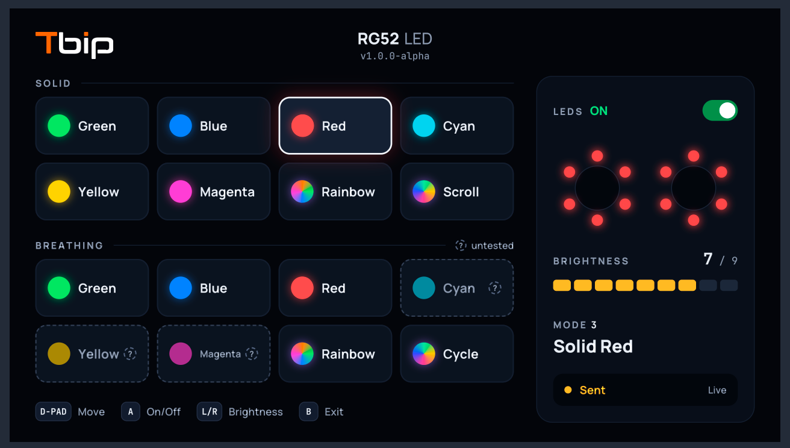
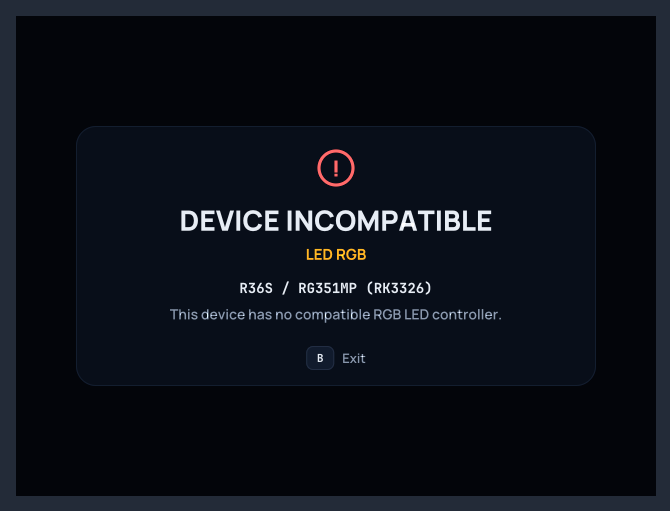

<p align="left">
  <picture>
    <source media="(prefers-color-scheme: dark)" srcset="docs/tbip-light.svg">
    <source media="(prefers-color-scheme: light)" srcset="docs/tbip-dark.svg">
    
  </picture>
</p>

<p align="left"><strong>Turning Bits Into Products</strong></p>

# led-rgb

Troca as cores dos LEDs RGB dos controles compatíveis com o dArkOS **em tempo real**, com interface
SDL2 controlada pelo D-pad. Em dispositivos com LEDs controlados pela MCU, o app usa o protocolo
UART descrito abaixo.

Reimplementa em Rust o que o `ledctl.sh` do
A implementação `ledctl.sh` disponível em distribuições dArkOS faz, mas sem reabrir a serial e sem
esperar a UI a cada troca.

| RG52 Mini | R36S (sem LED compatível) |
|---|---|
|  |  |

## Aparelhos

O app só funciona no **RG52 Mini e RG43 Pro** (RK3562), que têm a MCU de LED na UART1. Em qualquer outro aparelho ele mostra **DEVICE INCOMPATIBLE** e não abre a serial; o `rg52-ledctl` também recusa, a não ser com `--dev` explícito ou `--dry-run`.

O aparelho é identificado por `--device`, `/home/ark/.config/.DEVICE`, hostname e chip, nesta ordem. Os perfis ficam em `src/devices/`, pasta idêntica em led-rgb, remote-services e system-info. Use `--device ID` (`rg52mini`, `rg43`, `r36s`, `rgb10`, `a10mini`, `rk3566`, `generic`) ou `DEVICE_PROFILE=ID` no script para forçar um perfil.

## Como funciona (protocolo)

| Item | Valor |
|---|---|
| Porta | `/dev/ttyS1` (UART1), 9600 8N1 raw, **somente escrita** (a MCU não responde) |
| Comando | **1 byte**, enviado `repeat` vezes (6) com ~10 ms entre cópias |
| Init (obrigatório após ligar o trilho) | `0x20 + LEDs/4 - 1` → 12 LEDs = `0x22` |
| Modo | o próprio número: 1=G 2=B 3=R 4=G+B 5=R+G 6=B+R 7=rainbow 8=scroll 9=OFF, 17–24 = breathing |
| Brilho B (1–9) | byte `50 - B` |
| Alimentação | escrever `1`/`0` em `/sys/kernel/debug/regulator/vcc-led/enable` |

Sequência de uma troca: `[trilho on] → init (1ª vez) → modo → 50 ms → brilho`.

**Tempo real apesar do atraso.** Um envio completo leva centenas de ms. Os comandos rodam numa
thread própria e, se você mudar de cor várias vezes durante um envio, só o **último** estado é
enviado em seguida (os intermediários são descartados). A UI nunca trava e a cor final é sempre a
que você parou.

Não existe RGB livre nem controle por LED: as cores são as combinações/efeitos acima, decididos
pela firmware da MCU.

## Compilar

Precisa ser compilado para **aarch64** (o aparelho). O mais simples é num Debian Trixie arm64
(no próprio aparelho, num chroot do dArkOS ou em Docker com QEMU):

```bash
sudo apt install cargo libsdl2-dev pkg-config
cargo build --release          # binário: target/release/led-rgb
```

Num PC (para desenvolver a UI): o mesmo comando, mais `--dry-run` ao executar.
Só a biblioteca/protocolo, sem SDL2: `cargo test --no-default-features`.

## Instalar no dArkOS (menu Tools)

O script `scripts/LED RGB.sh` é o item do menu. Ele segue o padrão do `LED Settings.sh`
(usuário `ark`, `sudo`, tty1) e roda o app como root.

1. Compile o binário `led-rgb` para aarch64 (seção acima).
2. Descubra a pasta dos scripts do menu Tools: é a mesma onde está o `LED Settings.sh`
   (`find / -name "LED Settings.sh" 2>/dev/null`).
3. Copie para essa pasta:
   - `LED RGB.sh` (com permissão de execução: `chmod +x "LED RGB.sh"`);
   - o binário, de um destes jeitos: numa pasta `led-rgb/` ao lado do `.sh`
     (`led-rgb/led-rgb`), direto ao lado do `.sh`, ou em `/opt/led-rgb/led-rgb`.
4. Reabra o menu do EmulationStation: aparece "LED RGB".

O script copia o binário para `/tmp` antes de rodar, então funciona mesmo se ele estiver numa
partição FAT (sem bit de execução). Se o app falhar, a tela mostra as últimas linhas do log
(`/tmp/led-rgb.log`).

Variáveis de ambiente do script:
- `USE_GPTOKEYB=1`: usa o `gptokeyb` (gamepad → teclado) como o `LED Settings.sh`, e o script
  passa `--no-gamepad` ao app para não contar cada botão duas vezes. Confira se o
  `/opt/inttools/keys.gptk` mapeia D-pad, A, B, L1 e R1 para setas, Enter, Esc e `[` `]`.
- `SDL_VIDEODRIVER=kmsdrm`: só se a tela ficar preta (por padrão o SDL escolhe sozinho).

## Usar

Precisa de **root** (serial e debugfs), como o `ledctl.sh`, que o menu chama com `sudo`.

```bash
sudo ./led-rgb --fullscreen          # no aparelho
./led-rgb --dry-run                  # no PC: mostra os bytes em stderr, não toca em nada
```

| Controle | Ação |
|---|---|
| D-pad / setas | move o cursor; **cada movimento já envia a cor** (se os LEDs estiverem ligados) |
| A / Enter | liga/desliga os LEDs |
| Mouse / toque | clique num tile, no interruptor ou num segmento de brilho |
| L1 / R1 ou `[` `]` | brilho − / + |
| B / Esc | sair (os LEDs ficam como estão) |

Opções: `--dev`, `--pwr`, `--cfg`, `--leds N`, `--repeat N`, `--always-init`, `--dry-run`,
`--fullscreen`, `--no-gamepad`, `--accent amber|teal|violet|coral|#RRGGBB` (cor de destaque),
`--no-anim` (`--help` lista tudo). A configuração é lida/gravada em `led.cfg` no **mesmo
formato** do `ledctl.sh` (`ENABLED`, `MODE`, `BRI`, `LEDCOUNT`), então o menu antigo e o
`ledctl.sh apply` do boot continuam coerentes com o app.

A tela segue o design 960×540 (tema escuro, Manrope + JetBrains Mono embutidas, licença OFL em
`assets/fonts/`) e escala sozinha para a resolução, com faixas pretas se a proporção for diferente.
É desenhada por software (crate `ab_glyph`, sem SDL2_ttf). Cada anel mostra `LEDs/2` pontos (6 com
os 12 do aparelho). A pré-visualização é **aproximada** (rainbow/scroll são animados pela firmware;
na tela ficam estáticos, e o "breathing" só pulsa a opacidade). `--screenshot arq.ppm` salva um
quadro sem abrir janela.

## Testes por linha de comando (`led-rgbctl`)

Segundo executável, sem SDL2, para trocar cor/brilho e **explorar a MCU**. Precisa de root
(`sudo`); com `--dry-run` mostra os bytes sem tocar no hardware. `--help` lista tudo.

```bash
sudo ./target/release/led-rgbctl color red --bri 9          # cor + brilho
sudo ./target/release/led-rgbctl color rainbow --breath     # versão "respirando" (modo + 16)
sudo ./target/release/led-rgbctl bri 3                      # só o brilho (modo do led.cfg)
sudo ./target/release/led-rgbctl sweep --mode 3             # brilho 1..9, 1,5 s por passo
sudo ./target/release/led-rgbctl mode 12                    # qualquer byte de modo (0..255 ou 0x..)
sudo ./target/release/led-rgbctl mode 3 --bri-raw 50        # byte de brilho fora de 1..9
sudo ./target/release/led-rgbctl raw --init 3 44            # bytes crus (--init manda o handshake)
sudo ./target/release/led-rgbctl off
./target/release/led-rgbctl status                          # led.cfg e bytes calculados
```

Acrescente `--save` a `color`/`mode`/`bri` para gravar o resultado no `led.cfg`, e `--repeat 1`
para testar mais rápido (padrão 6).

### Descobrindo modos e níveis de brilho que ninguém mapeou

`scan` envia um byte por vez e você anota o que viu nos LEDs:

```bash
# modos 1..31 (padrão), brilho 5 fixo. Anotações vão para modos.txt
sudo ./led-rgbctl scan --out modos.txt

# bytes na posição do BRILHO (padrão 36..60) com o modo 7 fixo
sudo ./led-rgbctl scan --kind bri --mode 7
```

Em cada passo: **Enter** = próximo · `b` = voltar · `r` = reenviar · `g 0x10` = pular para o byte
· `q` = sair · qualquer outro texto = anotação daquele byte (ex.: `azul piscando`).
Sem ficar na frente do aparelho: `--auto 2` avança sozinho a cada 2 s.
Ao final aparece o resumo das anotações (e a gravação em `--out`, se pedido).

O que vale testar, pelo que já se sabe do protocolo:
- **Modos 10–16 e 25–31:** o menu original só usa 1–9 e 17–24. Se "breathing" é o bit `0x10`,
  as combinações acima de 8 podem ser outros efeitos ou nada.
- **Bytes ≥ 32 no lugar do modo** ficam na região do init (`0x20..`) e do brilho (41–49), então a
  MCU provavelmente os interpreta como outra coisa. Use `scan --from 32 --to 255` só se quiser
  mesmo explorar, e rode `led-rgbctl color red` depois para voltar ao normal.
- **Brilho:** a fórmula é `50 - B` para B = 1..9 (bytes 41..49). O `scan --kind bri` mostra se
  bytes vizinhos (36..40, 50..60) dão níveis intermediários, mais forte que 9 ou nada.
- Se algum modo parecer ignorado depois de outro, tente `--resend-bri` (reenvia o brilho a cada
  modo).

Enviar bytes avulsos é o mesmo que o `ledctl.sh raw` do dArkOS faz, mas **não há como saber o que a
firmware faz com bytes não documentados**. Para uma MCU de LEDs o risco é baixo; ainda assim, vá
aos poucos e anote.

## O que está verificado e o que não está

Verificado aqui (x86_64, sem o aparelho):
- bytes do protocolo, sequência (init só após ligar o trilho, desligar = `9` + cortar trilho),
  coalescência de comandos em rajada, `led.cfg`, lógica de navegação da UI e renderização da tela (pixels conferidos em testes);
- o transporte serial real contra um pseudo-terminal: bytes recebidos na ordem certa, porta em
  9600 8N1 raw, trilho ligado/desligado;
- a interface renderizada (SDL2, driver `dummy`);
- a lógica do `LED RGB.sh` com binários de mentira: binário ausente, sem bit de execução,
  em pasta ou ao lado do script, repasse de variáveis e propagação do código de erro.

**Não testado no hardware** (inclusive o launcher dentro do EmulationStation, o `gptokeyb` e o
vídeo KMSDRM) — vale conferir no aparelho, nesta ordem:
1. `--dry-run` primeiro, para ver a sequência.
2. Trocar de cor e ver se a MCU acompanha. Se ela parecer ignorar trocas, use `--always-init`
   (reenvia o handshake em todo envio, como o `ledctl.sh`).
3. Para ficar mais rápido: `--repeat 2` ou `--repeat 1`. O `ledctl.sh` usa 6; não se sabe se isso é
   necessário ou só redundância (a MCU não confirma nada).
4. Modos marcados com `?` (CYAN/YELLOW/MAGENTA respirando = 20/21/22) são **dedução** (base + 16);
   o menu original só oferecia 17, 18, 19, 23 e 24. Para explorar outros bytes use `led-rgbctl mode N` / `scan`.
5. O byte de init `0x22` para 12 LEDs também é inferido pelo autor do script original.

Não rode este app ao mesmo tempo que o `ledctl.sh`/menu "LED Settings": os dois escrevem na mesma
serial e os bytes se misturam.

## Estrutura

```
src/driver.rs   protocolo, transporte (UART real e dry-run), thread com coalescência
src/effects.rs  catálogo de modos + pré-visualização
src/config.rs   led.cfg
src/main.rs     laço SDL2 (textura + eventos) + testes da lógica de navegação
src/ui.rs       tela: modelo, layout do design, animações, hit-test do mouse
src/gfx.rs      rasterizador por software (formas suavizadas, brilho, texto)
src/bin/led-rgbctl.rs   ferramenta de linha de comando (color, mode, bri, sweep, scan, raw...)
src/session.rs  porta aberta para vários envios (usada pelo led-rgbctl)
assets/fonts/   Manrope e JetBrains Mono (subsets ASCII, OFL)
tests/uart_pty.rs   UART real contra um pty
tests/cli.rs    led-rgbctl rodando de verdade em --dry-run
scripts/LED RGB.sh  item do menu Tools do dArkOS
```

---

Ferramentas open source para consoles portáteis com dArkOS

A **Tbip** (*Turning Bits Into Products*, ou "transformando bits em produtos") desenvolve ferramentas **open source** para o [dArkOS](https://github.com/christianhaitian/dArkOS), sistema usado em consoles portáteis de jogos. Nosso objetivo é substituir telas de terminal e scripts por interfaces gráficas claras, feitas para usar com os botões do próprio aparelho.

Todas as ferramentas são escritas em **Rust** e usam **SDL2**. Elas identificam o aparelho automaticamente, mostram apenas o que ele possui e adaptam o layout à tela. 


## Open source

Nossos projetos são distribuídos sob a **licença MIT**. Você pode usar, estudar, modificar e redistribuir o código, inclusive em outros projetos, desde que mantenha o aviso de copyright e a licença.
